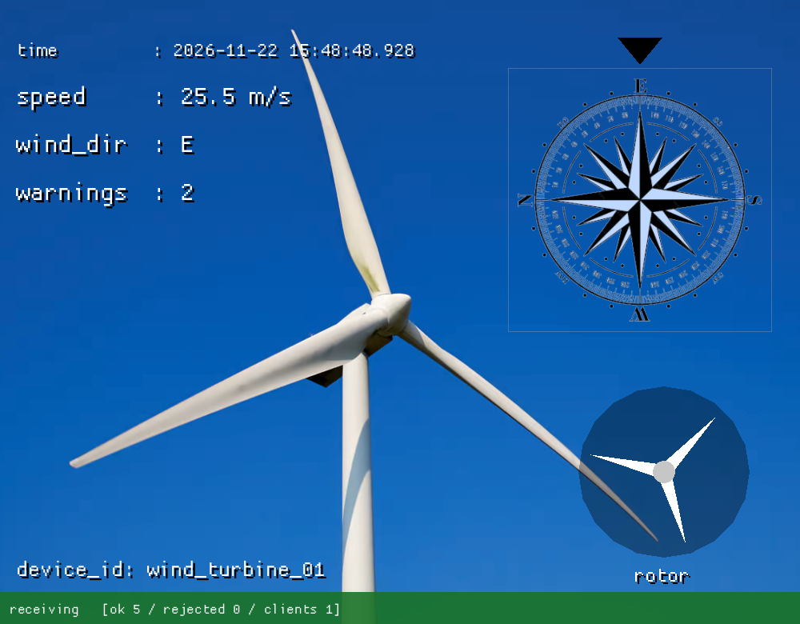
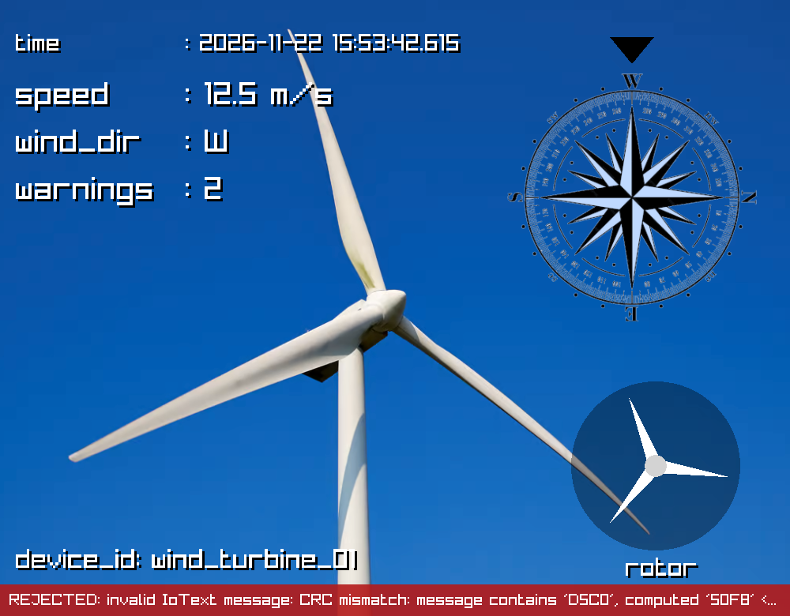

# Wind turbine demo

A small end-to-end demo of the [IoText data protocol](https://github.com/bieli/IoText-data-protocol)
with this crate (`iotext_rs`, used from the repository via a path dependency):

* **client**: a "wind turbine" in your terminal. Change speed, wind direction and warnings with
  the keyboard. Every change, plus a heartbeat once per second, is sent over TCP as one IoText
  line with a CRC.
* **dashboard**: a window that listens for those lines and shows the turbine state. It has a
  compass that turns to the wind direction and a rotor that spins with the wind speed.
  Rejected lines (bad CRC, wrong device, missing metric, ...) turn the status bar red.
  There are two dashboards with the same behaviour:
  * `wind_turbine_dashboard`: [macroquad](https://macroquad.rs), pure Rust, no system build tools
  * `wind_turbine_dashboard_raylib`: [raylib](https://www.raylib.com) 6 (needs cmake and a C compiler)



## Run

From this directory (`demos/wind_turbine`), in two terminals:

```bash
cargo run --release -p wind_turbine_dashboard          # or: -p wind_turbine_dashboard_raylib
cargo run --release -p wind_turbine_client
```

Both take an optional address (default `127.0.0.1:8688`), e.g. to accept clients from other
machines: `cargo run -p wind_turbine_dashboard -- 0.0.0.0:8688`.

### Client keys

| Key | Action |
|---|---|
| `Up` / `Down` (or `S` / `s`) | wind speed +1 / -1 m/s (0 ... 60) |
| `Right` / `Left` (or `W` / `w`) | wind direction clockwise / counter-clockwise (N, E, S, W) |
| `E` / `e` | warnings +1 / -1 |
| `x` | send one message with a broken CRC (the dashboard rejects it) |
| `q` / `Esc` | quit |

The client waits and reconnects if the dashboard isn't running yet.

### Without the client

The dashboard accepts any line-based TCP client, e.g.:

```bash
telnet 127.0.0.1 8688
t|1764000000000,d|wind_turbine_01,m|speed=d:12.5,m|wind_dir=t:W,m|warnings_cnt=i:1
```

The CRC item (`c|XXXX`) is optional, but when present it is checked.

## Message format

One turbine state is one IoText line terminated by `\n`:

```text
t|<unix ms>,d|wind_turbine_01,m|speed=d:<m/s>,m|wind_dir=t:<N|E|S|W>,m|warnings_cnt=i:<count>,c|<CRC16>
```

| Item | Meaning |
|---|---|
| `t\|...` | timestamp, UNIX milliseconds |
| `d\|wind_turbine_01` | device id; lines from other devices are rejected |
| `m\|speed=d:...` | wind speed in m/s (`d` decimal; `i` integer is accepted too) |
| `m\|wind_dir=t:...` | wind direction, `N`/`E`/`S`/`W` (case-insensitive) |
| `m\|warnings_cnt=i:...` | number of active warnings |
| `c\|...` | CRC-16 of everything before it |



## Layout

| Crate | Contents |
|---|---|
| `common` | message encoding and decoding (`TurbineMetrics`, `decode_line`), the TCP listener (`server`) and the renderer-independent dashboard state (`view`), all with unit tests |
| `client` | terminal client (crossterm) |
| `dashboard` | macroquad renderer |
| `dashboard_raylib` | raylib 6 renderer |

```bash
cargo test --workspace     # unit tests, including a real TCP round trip
```

On Linux both dashboards need the X11/OpenGL development packages (Debian/Ubuntu:
`libx11-dev libxi-dev libgl1-mesa-dev`); raylib additionally needs `cmake` and
`libxrandr-dev libxinerama-dev libxcursor-dev`.
